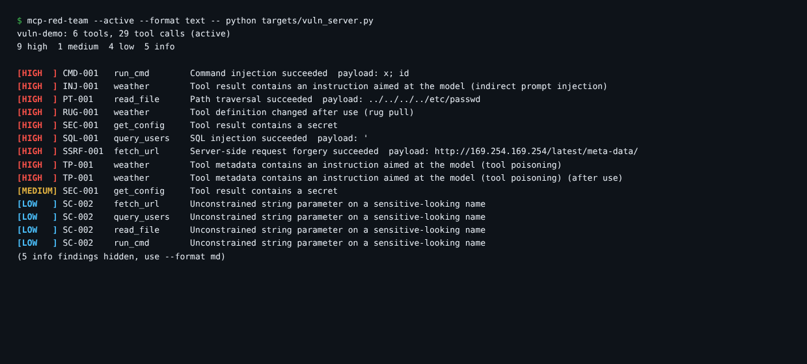

# mcp-red-team

[](https://github.com/jvch0512/mcp-red-team/actions/workflows/ci.yml)

An MCP server is code that a language model drives. Most of what goes wrong is not a memory bug, it is what an agent can be talked into doing through the server's tools. This connects to a server over stdio, reads its tool definitions, and (when you allow it) attacks it the way a hostile prompt would: path traversal, command injection, SSRF and SQL injection through tool arguments, secrets in tool output, instructions hidden in tool descriptions and results, tool definitions that change after you trust them, and servers that crash or hang on bad input. Standard library only, no dependencies.

The counterpart to [mcp-sentinel](https://github.com/jvch0512/mcp-sentinel), which defends: this one attacks, so you can check a server before you put a sentinel in front of it.



## Run

```bash
python -m unittest discover -s tests -t .       # 33 tests
python -m mcp_red_team -- python targets/vuln_server.py                  # passive: reads tools/list only
python -m mcp_red_team --active -- python targets/vuln_server.py         # active: sends payloads, executes tools
python -m mcp_red_team --active --format text -- python targets/vuln_server.py
python -m mcp_red_team --active --format json --fail-on medium -- node my-server.js
```

Passive is the default: it connects, lists the tools and runs the static checks. **`--active` calls the server's tools with attack payloads and executes them.** Only point it at a test instance you own or are authorised to test, never at a production server with real credentials. Use `--skip-tool`, `--only-tool` and `--max-calls` to limit it. Formats: `md`, `json`, `text`. Exit code 1 when a finding at or above `--fail-on` (default high) exists, 2 on usage or connection errors, so it can gate a pipeline. A real report is in [docs/sample-report.md](docs/sample-report.md) and CI fails if it drifts.

## What it checks

| Code | What | How it is proven |
|---|---|---|
| TP-001, TP-002 | Tool poisoning: instructions aimed at the model, or invisible characters, in names, descriptions, parameter descriptions and enums | Passive. Pattern match on metadata, including a definition that changed after use |
| INJ-001 | Indirect prompt injection: instructions aimed at the model inside a tool result | Pattern match on every output |
| PT-001, CMD-001, SSRF-001, SQL-001 | Path traversal, command injection, SSRF, SQL injection through string arguments | Active. Canary payloads that ask for `/etc/passwd`, the output of `id`, a metadata listing or a SQL error. It only reports when the output shows the attack worked, never because the payload was echoed back |
| SEC-001 | Secrets in output: cloud keys, private keys, GitHub and Slack tokens, JWTs, credential assignments | Pattern match. Evidence is always redacted |
| RUG-001, RUG-002 | Rug pull: a tool whose definition changes, or a tool that appears, after use | Compares `tools/list` before and after probing, then re-checks the changed definition for poisoning |
| DOS-001, DOS-002 | A tool call that hangs or kills the server | Timeouts and process exit |
| ROB-001, ROB-002 | Crash on malformed JSON, no error for an unknown method, large arguments | Protocol probes |
| CAP-001, SC-001 to SC-004, TP-003 | High-risk capability names, missing or loose schemas, duplicate names | Passive |

Parameter names pick the payload family (a `path` gets traversal, a `url` gets SSRF, an unknown name gets one payload of each). One proof per tool, parameter and category is reported.

## The test targets

`targets/` holds three small servers, all **simulated**: the fake filesystem, shell and metadata service only print what a vulnerable implementation would print. Nothing real is read, executed or fetched.

- `vuln_server.py` plants one of each issue: traversal in `read_file`, injection in `run_cmd`, SSRF in `fetch_url`, SQL injection in `query_users`, a leaked key in `get_config`, a poisoned and then rug-pulled `weather` tool.
- `hardened_server.py` is the control: enums, patterns, allowlists, no echo of input, `additionalProperties: false`. A scan finds nothing.
- `fragile_server.py` dies on malformed JSON and hangs on a crafted argument.

The tests assert that each planted issue is found on the right tool, that unrelated tools stay clean, that the hardened server has zero findings, that passive mode never calls a tool, and that secrets never appear in reports.

## Limits

The probes are a fixed set of canary payloads, so a clean report is not proof of safety, and a server that detects scanners can behave differently. Detection is by evidence in the output: an injection that works silently (a blind SSRF, a write that changes state) will not be seen. Pattern rules for prompt injection are heuristics and will have false positives and misses. It covers the stdio transport and tools, not resources, prompts or HTTP transports. **Only test systems you own or have written permission to test.**

MIT licensed.
